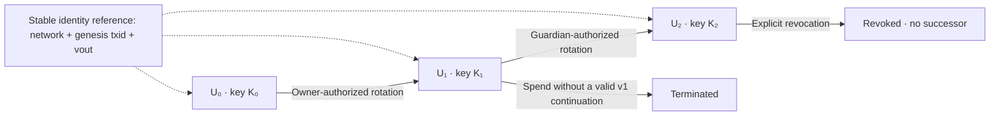
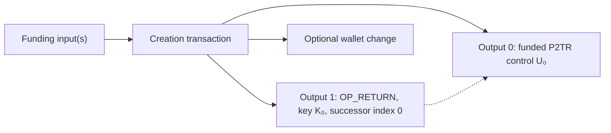
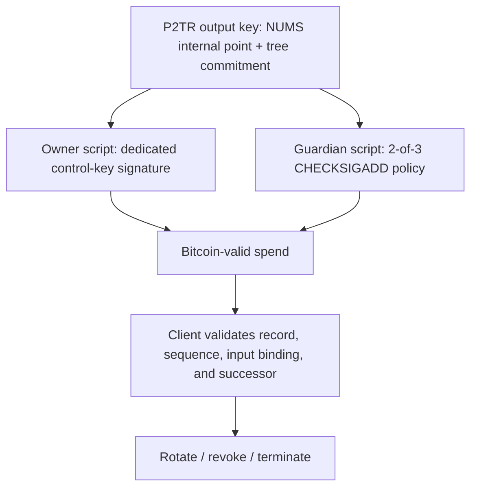

# Rooted diagrams

The site's accessible diagrams are rendered in `app/components/diagrams.tsx` and `app/components/explorer.tsx`. These Mermaid versions provide portable source for reviewers. All transaction IDs, keys, and indices in the illustrations are conceptual placeholders.

## Identity lifecycle

All transitions shown require confirmed Bitcoin-valid spends in the chosen chain view. Missing verification data produces an unresolved result. A reorg can undo a transition.

## Creation transaction

## Taproot authorization policy

The branches are alternatives. The key path is assumed computationally unavailable only when the NUMS construction is sound. Neither branch forces a successor or guarantees recovery-policy inheritance.
